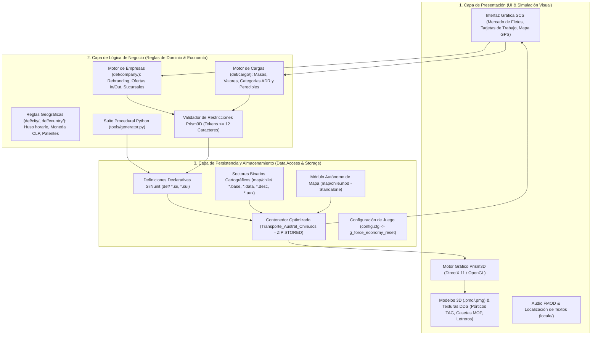
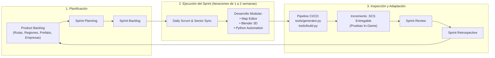
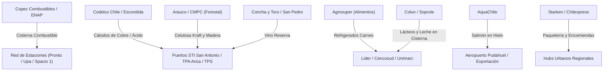

# 🇨🇱 Transporte Austral - Mod de Mapa de Chile para Euro Truck Simulator 2 (ETS2)


[](https://eurotrucksimulator2.com/)
[](https://www.python.org/)
[]()
[]()
[](LICENSE)
[]()

> **Transporte Austral** es un proyecto de modificación integral de mapa para **Euro Truck Simulator 2**, dedicado a recrear la geografía completa de **Chile** de extremo a extremo: desde el altiplano y el desierto más árido del mundo en el norte, pasando por los valles agrícolas y las autopistas urbanas centrales, hasta los fiordos, lagos, volcanes y las desafiantes rutas de ripio y glaciares de la **Patagonia y Carretera Austral**.

---

## 📑 Tabla de Contenidos

1. [Visión y Alcance del Proyecto](#-visión-y-alcance-del-proyecto)
2. [Arquitectura del Sistema: Patrón de 3 Capas](#-arquitectura-del-sistema-patrón-de-3-capas)
3. [Metodología de Desarrollo: SCRUM Ágil](#-metodología-de-desarrollo-scrum-ágil)
4. [Stack Tecnológico y Herramientas](#-stack-tecnológico-y-herramientas)
5. [Las 16 Regiones de Chile Recreadas](#-las-16-regiones-de-chile-recreadas)
6. [Red de Rutas y Carreteras Chilenas](#-red-de-rutas-y-carreteras-chilenas)
7. [Empresas Chilenas y Cadenas Logísticas](#-empresas-chilenas-y-cadenas-logísticas)
8. [Estaciones de Servicio y Áreas de Descanso](#-estaciones-de-servicio-y-áreas-de-descanso)
9. [Cargas y Mercancías Nacionales](#-cargas-y-mercancías-nacionales)
10. [Sistema de Patentes Chilenas Oficiales](#-sistema-de-patentes-chilenas-oficiales)
11. [Suite de Automatización y DevOps (`tools/`)](#-suite-de-automatización-y-devops-tools)
12. [Guía Paso a Paso: SCS Map Editor](#-guía-paso-a-paso-scs-map-editor)
13. [Flujo 3D: Blender y SCS Blender Tools](#-flujo-3d-blender-y-scs-blender-tools)
14. [Estructura del Proyecto](#-estructura-del-proyecto)
15. [Compilación e Instalación](#-compilación-e-instalación)
16. [Hoja de Ruta (Roadmap)](#-hoja-de-ruta-roadmap)

---

## 🌟 Visión y Alcance del Proyecto

Chile posee una de las geografías más singulares y desafiantes del planeta: más de **4.300 km de longitud**, una anchura promedio de 177 km y un relieve dominado por la **Cordillera de los Andes**, la Depresión Intermedia y la Cordillera de la Costa. 

Transporte Austral recrea la experiencia de conducción y transporte pesado chileno con máxima fidelidad técnica:
* **Desafíos reales de conducción:** Cuestas extremas (Cuesta Caracoles, Cuesta de Lipán, Cuesta Queulat), rutas costeras sinuosas, vientos cruzados patagónicos, autopistas urbanas concesionadas con pórticos TAG y pasos fronterizos sobre los 3.000 msnm.
* **Economía y logística nacional:** Reemplazo integral del mercado de fletes europeo por 146 empresas activas de bandera chilena (retail, faenas mineras en rajo abierto, plantas de celulosa forestal, cooperativas lecheras, salmoneras y puertos internacionales).
* **Ambientación fotorrealista:** Señalización vial según el **Manual de Señalización de Tránsito del MOP**, servicentros Copec Pronto, Shell Upa! y Petrobras Spacio 1, y patentes oficiales reguladas por el Registro Civil.

---

## 🏛️ Arquitectura del Sistema: Patrón de 3 Capas

El proyecto está diseñado bajo una **Arquitectura de 3 Capas (Three-Tier Architecture)** para garantizar una estricta separación de responsabilidades, alta mantenibilidad, escalabilidad cartográfica y aislamiento frente a fallos del motor de juego:



### 1. Capa de Presentación (Presentation / Client Layer)
Responsable de todo lo que el usuario final visualiza e interactúa en cabina y en los menús del simulador:
* **Interfaz de Usuario (UI):** Menús de selección de fletes (Trabajo Rápido / Mercado de Cargas), visualizador de ofertas de trabajo con tarjetas de ciudades limpias y sin desbordes de texto (`Curicó (CL) ► Copiapó (CL)`), minimapa GPS con marcadores de iconos personalizados.
* **Pipeline de Renderizado 3D:** Motor gráfico **Prism3D** ejecutando shaders especializados de SCS (`eut2.dif.spec.weight`, `eut2.road.airship`, `eut2.glass`), modelos de terreno, puentes y vegetación autóctona.
* **Activos Gráficos y Multimedia:** Texturas comprimidas en DirectDraw Surface (DDS) con canales alfa BC1/BC3, sistemas de partículas de polvo/lluvia y soporte multilingüe en `locale/`.

### 2. Capa de Lógica de Negocio (Business Logic / Domain Layer)
Controla las reglas operativas, flujos de transporte y restricciones del universo simulado:
* **Dominio Económico y Logístico:** Definición de cadenas de suministro (ofertas de origen `out/` y recepción `in/`), asignación de sucursales en editor (`company_def`) y vinculación directa de prefabs 3D del mapa base con marcas chilenas sin rotura de dependencias.
* **Reglas Normativas Chilenas:** Implementación del formato oficial de matrículas del Servicio de Registro Civil (`BB·BB-00` y remolques `R0·12-34`), moneda nacional (Peso Chileno `$CLP`), husos horarios continentales (`UTC-3` / `UTC-4`) e insulares, y límites de velocidad viales.
* **Guardias y Validadores de Arquitectura:** Módulo de validación de identificadores de SCS (imposición matemática de nombres de tokens $\le 12$ caracteres para prevenir fallos de carga en el Sii loader).
* **Automatización Procedural:** Orquestador de definiciones en Python que asegura el principio de *Single Source of Truth* (SSOT) para más de 146 empresas y 52 comunas.

### 3. Capa de Persistencia y Datos (Data & Persistence Layer)
Maneja el almacenamiento en disco, los formatos binarios del mapa y la persistencia de perfiles:
* **Bases de Datos Cartográficas:** Archivos de sectores binarios indexados por coordenadas cartesianas (`sec-XXXX+YYYY.base/data/desc/aux`) y el archivo de cabecera de mundo independiente (`map/chile.mbd`).
* **Formatos Declarativos:** Esquemas de datos en formato **SiiNunit** (`.sii`, `.sui`) que alimentan al motor de base de datos relacional interna del simulador.
* **Paquete de Distribución y Caché:** Archivo contenedor `Transporte_Austral_Chile.scs` estructurado como un archivo ZIP sin compresión (método `STORED`), eliminando penalizaciones de descompresión en tiempo real y asegurando *frame times* estables.

---

## 🏃 Metodología de Desarrollo: SCRUM Ágil

El desarrollo de **Transporte Austral** se ejecuta bajo el marco de trabajo **SCRUM**, adaptado al desarrollo iterativo e incremental de software y modding para simuladores de mundo abierto:



### Roles Scrum
* **Product Owner (PO):** Define la visión del producto, prioriza la hoja de ruta nacional (selección de rutas troncales, puertos prioritarios y acuerdos con la comunidad de camioneros virtuales).
* **Scrum Master (SM):** Facilita los procesos ágiles, elimina impedimentos técnicos del motor Prism3D (resolución de crasheos, optimización de draw-calls), supervisa los estándares de SCS Software y vela por la integración continua.
* **Development Team (Equipo Multidisciplinario):**
  * *Ingenieros de Software / Automatización:* Mantenimiento de la suite de Python (`tools/`), lógica de compilación, generadores y validadores.
  * *Diseñadores de Nivel / Cartógrafos:* Trazado de carreteras, elevaciones topográficas, paisajismo y colocación de prefabs en SCS Map Editor.
  * *Artistas Técnicos 3D:* Modelado en Blender de señalética MOP, garitas, peajes y optimización de texturas DDS.

### Artefactos Scrum
1. **Product Backlog:** Registro centralizado de historias de usuario, épicas territoriales (e.g., *"Como camionero virtual quiero recorrer la Cuesta Caracoles con curvas cerradas para experimentar el transporte cordillerano real"*).
2. **Sprint Backlog:** Subconjunto de ítems, sectores cartográficos y definiciones seleccionadas para el Sprint actual.
3. **Incremento de Software (Potentially Shippable Product):** Un archivo `.scs` completamente funcional, compilado y testeado tras cada iteración, libre de advertencias críticas en `game.log.txt`.

### Ceremonias Scrum
* **Sprint Planning:** Definición del objetivo del Sprint (Sprint Goal) y asignación de sectores geográficos.
* **Daily Scrum:** Sincronización sobre sectores binarios editados con [`tools/sector_helper.py`](file:///e:/Proyectos/Transporte_Austral/tools/sector_helper.py) para evitar colisiones y sobrescritura de archivos binarios.
* **Sprint Review:** Pruebas de conducción in-game en perfiles limpios, validando la economía de fletes y la visibilidad de empresas chilenas.
* **Sprint Retrospective:** Análisis de incidentes (por ejemplo, identificación del límite de 12 caracteres en tokens) y creación de reglas automáticas preventivas en el pipeline.

### Registro de Sprints
* **Sprint 1 — Cimientos & Módulo Independiente (Completado):**
  * Configuración del mapa standalone `chile.mbd`.
  * Generación de las 16 regiones administrativas y 52 comunas base.
  * Sistema de patentes oficiales según Registro Civil chileno.
* **Sprint 2 — Ecosistema Empresarial & Cadenas Logísticas (Completado):**
  * Integración de 47 empresas nacionales y sustitución de prefabs europeos mediante 146 marcas activas.
  * Mapeo de servicentros Copec Pronto, Shell Upa! y Petrobras Spacio 1.
  * Ingesta de 340 cargas locales e importadas.
* **Sprint 3 — Estabilización, Refactorización UI & Zero Crashes (Completado):**
  * Diagnóstico y solución del fallo de token >12 caracteres en Prism3D.
  * Saneamiento de nombres de ciudades en tarjetas UI de fletes.
  * Blindaje preventivo en [`tools/build.py`](file:///e:/Proyectos/Transporte_Austral/tools/build.py).
* **Sprint 4 — Trazado Cartográfico Zona Central (En Curso):**
  * Modelado de la Ruta 5 Sur (Santiago - Talca) y conexión a San Antonio (Ruta 78).

---

## 💻 Stack Tecnológico y Herramientas

| Categoría | Tecnología / Herramienta | Versión | Rol en el Proyecto |
| :--- | :--- | :--- | :--- |
| **Core & Automatización** | **Python** | 3.12+ | Generación procedimental de definiciones SiiNunit, validación de integridad, parsers y compilación. |
| **Shell & Scripting** | **PowerShell & Batch** | Windows Shell | Automatización de lanzadores con un clic (`run_editor.bat`, `iniciar_trayectoria.bat`). |
| **Lenguaje Declarativo** | **SiiNunit DSL** | SCS Proprietary | Definición de estructuras de datos para entidades de juego (`.sii`, `.sui`). |
| **Motor de Juego** | **SCS Prism3D** | v1.50 - 1.53+ | Motor de físicas, renderizado gráfico en tiempo real, simulación y gestión de tráfico IA. |
| **Editor de Nivel** | **SCS Map Editor** | 64-bit Native | Trazado de geometría vial, topografía, colocación de prefabs y nodos de ciudades. |
| **Modelado 3D** | **Blender** | 3.6 LTS / 4.x | Creación de modelos 3D de infraestructura chilena (pórticos TAG, peajes, letreros). |
| **Pipeline 3D** | **SCS Blender Tools** | v2.4+ | Exportación de mallas, materiales, locators y colisiones al formato nativo `.pmd`/`.pmg`. |
| **Formatos Gráficos** | **DirectDraw Surface (DDS)** | BC1 / BC3 / BC7 | Texturas optimizadas con compresión por hardware para minimización de consumo VRAM. |
| **Audio & SFX** | **FMOD Studio** | SCS Spec | Integración de sonidos ambientales y efectos acústicos regionales. |
| **Control de Versiones** | **Git & GitHub** | 2.40+ | Control de versiones del código fuente, definiciones y documentación. |
| **Pipeline CI/CD Local** | **Custom Python Runner** | In-House | Validación automática, linter de sintaxis, empaquetado STORED e inyección en directorio de ETS2. |

---

## 🗺️ Las 16 Regiones de Chile Recreadas

El proyecto abarca la totalidad del territorio continental de Chile, dividido en sus 16 regiones administrativas, sus comunas clave y sus hitos geográficos más emblemáticos:

| N° | Región | Comunas Principales | Hitos y Monumentos Icónicos |
| :--- | :--- | :--- | :--- |
| **XV** | **Arica y Parinacota** | Arica, Putre, Camarones | El Morro de Arica, Valle de Azapa, Lago Chungará, Volcán Parinacota, Paso Chacalluta |
| **I** | **Tarapacá** | Iquique, Alto Hospicio, Pozo Almonte, Pica | Bajada de Alto Hospicio, Salitreras Humberstone, Cerro Dragón, Puerto de Iquique, ZOFRI |
| **II** | **Antofagasta** | Antofagasta, Calama, San Pedro, Mejillones | Monumento Natural La Portada, Mano del Desierto (Ruta 5), Rajo de Chuquicamata, Valle de la Luna |
| **III** | **Atacama** | Copiapó, Caldera, Vallenar, Chañaral | Desierto Florido, Playas de Bahía Inglesa, Mina San José (los 33), Parque Pan de Azúcar |
| **IV** | **Coquimbo** | La Serena, Coquimbo, Ovalle, Los Vilos | Faro Monumental de La Serena, Cruz del Tercer Milenio, Valle del Elqui, Cuesta Porotitos |
| **V** | **Valparaíso** | Valparaíso, Viña del Mar, San Antonio, Los Andes | Ascensores patrimoniales, Reloj de Flores, Puerto STI de San Antonio, Cuesta Caracoles (Paso Los Libertadores) |
| **RM** | **Metropolitana de Santiago** | Santiago Centro, San Bernardo, Pudahuel, Quilicura | Gran Torre Costanera Center, Cerro San Cristóbal, Hub Logístico San Bernardo, Autopista Central |
| **VI** | **O'Higgins** | Rancagua, San Fernando, Santa Cruz, Rengo | Sewell y Mina El Teniente, Carretera del Vino (Colchagua), Complejo Agroindustrial Agrosuper |
| **VII** | **Maule** | Talca, Curicó, Linares, Constitución | Río Maule, Planta Celulosa Arauco Constitución, Radal Siete Tazas, Viñedos del Maule |
| **XVI** | **Ñuble** | Chillán, San Carlos, Bulnes, Quirihue | Mercado Central de Chillán (cecinas artesanales), Volcán Chillán, Termas de Chillán |
| **VIII** | **Biobío** | Concepción, Talcahuano, Los Ángeles, Coronel | Puentes sobre el Río Biobío, Reliquia Histórica Huáscar, Complejo Forestal MAPA, Salto del Laja |
| **IX** | **La Araucanía** | Temuco, Villarrica, Pucón, Angol, Victoria | Volcán Villarrica humeante, Cerro Ñielol, Bosques de Araucarias milenarias, Viaducto del Malleco |
| **XIV** | **Los Ríos** | Valdivia, La Unión, Río Bueno, Panguipulli | Río Calle-Calle con lobos marinos, Cervecería Kunstmann Torobayo, Planta Láctea Colun, Puentes de Niebla |
| **X** | **Los Lagos** | Puerto Montt, Osorno, Castro, Quellón, Chaitén | Inicio de Carretera Austral, Transbordadores Canal de Chacao, Palafitos de Castro, Hito Cero Panamericana |
| **XI** | **Aysén del Gral. Ibáñez** | Coyhaique, Puerto Aysén, Puerto Chacabuco, Cochrane, Villa O'Higgins | Capillas de Mármol en Lago General Carrera, Cumbres afiladas del Cerro Castillo, Ventisquero Colgante Queulat, Cuesta Queulat |
| **XII** | **Magallanes y Antártica** | Punta Arenas, Puerto Natales, Porvenir | Macizo de las Torres del Paine, Estrecho de Magallanes, Barcaza Primera Angostura en Tierra del Fuego |

---

## 🛣️ Red de Rutas y Carreteras Chilenas

### 1. Ruta 5 Panamericana (Eje Troncal Nacional)
* **Ruta 5 Norte (Arica - Santiago):** Dobles vías alternadas con tramos desérticos épicos, amplias rectas rodeadas de cerros de arena, cuestas desafiantes (Cuesta Pajonales, Cuesta Buenos Aires) y plazas de peaje troncales.
* **Autopistas Urbanas de Santiago:** Concesiones urbanas con **pórticos TAG electrónicos**, túneles bajo el Río Mapocho (Costanera Norte) y enlaces troncales en Autopista Central y Américo Vespucio.
* **Ruta 5 Sur (Santiago - Puerto Montt):** Doble calzada con separador arbolado, puentes sobre ríos caudalosos, básculas de pesaje MOP, pasos por By-pass Rancagua, Talca, Chillán, Temuco y el viaducto del Río Biobío.
* **Cruce Marítimo Bimodal Canal de Chacao:** Transbordadores para ingresar a la Isla Grande de Chiloé (Ancud, Castro y Quellón).

### 2. Ruta 7 (La Carretera Austral)
* **Tramo Norte (Puerto Montt a Chaitén):** Ruta Bimodal con transbordadores marítimos entre Hornopirén, Leptepu y Caleta Gonzalo.
* **Tramo Central (Puyuhuapi - Coyhaique):** Ascenso por la dramática **Cuesta Queulat**, curvas cerradas en pendiente extrema, cascadas y puentes monovía de madera y acero.
* **Tramo Sur (Coyhaique a Villa O'Higgins):** Bordeando el Río Baker y Lago General Carrera, con superficie de ripio compactado de alta exigencia técnica.

### 3. Pasos Internacionales y Rutas Conexas
* **Ruta 68:** Santiago a Valparaíso y Viña del Mar, atravesando los túneles Lo Prado y Zapata.
* **Ruta 78 (Autopista del Sol):** Conexión logística hacia el megapuerto de San Antonio.
* **Ruta 60-CH (Paso Los Libertadores):** La icónica subida de los **Caracoles de Juncal** con 29 curvas en herradura hacia el túnel Cristo Redentor.
* **Ruta 9 y Rutas Fueguinas:** Pampas patagónicas con cruce en barcaza por el Estrecho de Magallanes (Punta Delgada - Bahía Azul).

---

## 🏢 Empresas Chilenas y Cadenas Logísticas

El mod incorpora **146 empresas activas** en la economía del mapa, conectando cadenas de valor realistas:



### Principales Sectores Industriales
1. **⛽ Combustibles y Energía:** Copec (`copec`), Shell Enex (`shell_cl`), Petrobras (`petrobras`), Aramco (`aramco`), ENAP (`enap`).
2. **⛏️ Minería y Siderurgia:** Codelco (`codelco`), Minera Escondida (`escondida`), SQM (`sqm`), CAP Acero (`cap_acero`), Molymet (`molymet`).
3. **🌲 Forestal y Papel:** Arauco (`arauco`), Empresas CMPC (`cmpc`).
4. **🥩 Alimentos y Agroindustria:** Agrosuper (`agrosuper`), Colun (`colun`), Soprole (`soprole`), Carozzi (`carozzi`), Iansa (`iansa`), Panadería Ideal (`ideal_cl`), Watt's (`watts`), Dole Chile (`dole_cl`), AquaChile (`aquachile`).
5. **🍻 Bebidas y Viñedos:** CCU (`ccu`), Coca-Cola Andina (`andina`), Coca-Cola Embonor (`embonor`), Viña Concha y Toro (`concha_toro`), Cerveza Kunstmann (`kunstmann`), Cerveza Austral (`austral_pza`).
6. **🛒 Retail y Construcción:** Lider Walmart (`lider`), Cencosud Jumbo/Easy (`cencosud`), Unimarc (`unimarc`), Falabella (`falabella`), Sodimac (`sodimac`), Cemento Melón (`melon`), Polpaico (`polpaico`).
7. **📦 Courier y Logística:** Starken (`starken`), Chilexpress (`chilexpress`), CorreosChile (`correos_cl`), Blue Express (`bluex`).
8. **⚓ Puertos y Ferries:** STI San Antonio (`sti_san_ant`), TPS Valparaíso (`tps_valp`), TPA Arica (`tpa_arica`), Puerto Coronel (`pto_coronel`), TABSA (`tabsa`).

---

## ⛽ Estaciones de Servicio y Áreas de Descanso

* **Copec Pronto:** Diseños con estacionamientos para combinaciones pesadas de 45 toneladas, servicios higiénicos, duchas y áreas de descanso (ej: *Copec Pronto San Francisco de Mostazal*, *Copec Pronto Los Vilos*, *Copec Salto del Laja*, *Copec La Negra en Antofagasta*).
* **Shell Upa! / Upita:** Estaciones modernas con paradores de descanso interurbanos.
* **Petrobras Spacio 1:** Módulos de abastecimiento en autopistas y radios urbanos.
* **Básculas de Pesaje MOP:** Estaciones oficiales de pesaje dinámico y estático por eje de la Dirección de Vialidad.

---

## 📦 Cargas y Mercancías Nacionales

Ubicadas y configuradas en [`def/cargo/`](file:///e:/Proyectos/Transporte_Austral/def/cargo/):
* `catodos_cobre`: Cátodos electrolíticos de alta pureza (24 t, alto valor).
* `celulosa_fardo`: Fardos prensados de celulosa Kraft (22,5 t).
* `salmon_fresco`: Cajas isotérmicas con salmón fresco en hielo (19 t, perecible).
* `vino_reserva`: Pallets de vino embotellado de exportación (18,5 t, frágil).
* `leche_sur`: Cisterna isotérmica con leche fresca Colun (25 t líquidas).
* `combustible_cl`: Gasolinas y diésel Ultra Copec (26 t, carga ADR).
* `palta_hass`: Pallets de exportación de valles de Quillota/Petorca (17,5 t).
* `encomiendas_cl`: Cargas consolidadas de courier y paquetería (12 t).

---

## 🪪 Sistema de Patentes Chilenas Oficiales

Implementado en [`def/country/chile/license_plates.sui`](file:///e:/Proyectos/Transporte_Austral/def/country/chile/license_plates.sui) según la normativa del **Servicio de Registro Civil e Identificación**:
* **Patentes de Vehículos:** Estructura `BB·BB-00` (4 consonantes y 2 dígitos).
* **Restricción de Caracteres:** Exclusión formal de las 5 vocales ($A, E, I, O, U$) y de las letras $M, N, Ñ, Q$ para prevenir duplicidades y confusiones ópticas con dígitos.
* **Patentes de Remolques:** Series con prefijo `R` para semirremolques pesados (`R0·12-34`).

---

## 🐍 Suite de Automatización y DevOps (`tools/`)

Ubicada en la carpeta [`tools/`](file:///e:/Proyectos/Transporte_Austral/tools/):

### 1. `generator.py` (Generador de Definiciones)
Regenera procedimentalmente todas las definiciones `.sui` y `.sii` de regiones, ciudades, empresas, cargas, gasolineras y localización con un solo comando:
```bash
python tools/generator.py
```

### 2. `geo_converter.py` (Conversor GPS WGS84 a Coordenadas SCS)
Traduce coordenadas de Latitud y Longitud reales a los ejes $(X, Z)$ del editor e identifica el sector binario exacto:
```bash
# Ejemplo: Coordenadas de las Torres del Paine
python tools/geo_converter.py -51.7269 -72.5069
```
*Salida:*
```text
Lat: -51.7269, Lon: -72.5069 -> ETS2 X: -7918, Z: 106970 -> Sector: sec-0002+0026.base
```

### 3. `build.py` (Pipeline de Compilación, Validación y Despliegue)
Valida la integridad del árbol de dependencias, comprueba límites de tokens ($\le 12$ caracteres) y compila el paquete final `Transporte_Austral_Chile.scs` en modo `STORED`:
```bash
python tools/build.py
```
*Si detecta la instalación de ETS2, copia automáticamente el paquete compilado a la carpeta `Documents/Euro Truck Simulator 2/mod/` y activa `g_force_economy_reset` para refrescar fletes.*

### 4. `sector_helper.py` (Gestor de Sectores y Copias de Seguridad)
Audita los sectores binarios creados en `map/chile/` y genera respaldos fechados:
```bash
python tools/sector_helper.py
python tools/sector_helper.py backup
```

### 5. `launcher.py` / `iniciar_trayectoria.bat`
Lanzador interactivo para seleccionar regiones y sortear comunas de inicio:
```bash
python tools/launcher.py
# O doble clic en iniciar_trayectoria.bat
```

---

## 🛠️ Guía Paso a Paso: SCS Map Editor

### Paso 1: Habilitar Modo Desarrollador y Consola
En `Documents\Euro Truck Simulator 2\config.cfg`:
```text
uset g_developer "1"
uset g_console "1"
```

### Paso 2: Ejecutar el Editor
Ejecuta el script [`tools/run_editor.bat`](file:///e:/Proyectos/Transporte_Austral/tools/run_editor.bat) o inicia desde terminal:
```powershell
& "C:\Program Files (x86)\Steam\steamapps\common\Euro Truck Simulator 2\bin\win_x64\eurotrucks2.exe" -edit chile -force_mods
```

### Paso 3: Comandos Esenciales (Tecla `~`)
* `c_goto <X> 100 <Z>`: Salto instantáneo a coordenadas calculadas con `geo_converter.py`.
* `save chile`: Guarda todos los cambios en `map/chile/`.
* `load chile`: Recarga el mapa guardado.
* `F5`: Diálogo de búsqueda y sectores.
* Atajos de edición: `E` (Carreteras), `P` (Prefabs/Cruces), `M` (Nodos/Alturas), `C` (Ciudades).

---

## 🎨 Flujo 3D: Blender y SCS Blender Tools

Para modelar activos propios de Chile (pórticos TAG, peajes manuales MOP, letreros viales, garitas):
1. **Blender:** Versión 3.6 LTS o 4.x.
2. **SCS Blender Tools:** Plugin oficial configurado con Project Root en la raíz de `Transporte_Austral`.
3. **Texturas y Shaders:** Usar shaders `eut2.*` y exportar texturas en formato DDS (BC1 opaco, BC3 con transparencia).
4. **Exportación:** Compilar los modelos para generar los formatos `.pmd`, `.pmg` y `.mat`.

---

## 📁 Estructura del Proyecto

```text
Transporte_Austral/
│
├── manifest.sii                  # Descriptor y metadatos oficiales del mod para ETS2
├── description.txt               # Descripción con formato bbcode para el Gestor de Mods
├── mod_icon.png                  # Icono oficial de portada del mod
├── README.md                     # Manual maestro y arquitectura del proyecto
│
├── def/                          # Capa de Lógica de Negocio (SiiNunit DSL)
│   ├── country.sii               # Inclusión maestra de país
│   ├── country/
│   │   ├── chile.sui             # Definición de país: moneda CLP, velocidades, husos
│   │   └── chile/
│   │       └── license_plates.sui# Formato oficial de patentes según Registro Civil
│   ├── city.sii                  # Inclusión maestra de ciudades
│   ├── city/                     # 52 archivos .sui para comunas y ciudades de Chile
│   ├── company.sii               # Inclusión maestra de 146 empresas activas
│   ├── company/                  # Definiciones .sui, sucursales (editor/) e in/out
│   ├── cargo.sii                 # Inclusión maestra de cargas nacionales
│   ├── cargo/                    # Cargas chilenas (cobre, celulosa, salmón, vino, etc.)
│   └── world/
│       └── gasoline_station*.sii # Red de servicentros Copec, Shell, Petrobras, Aramco
│
├── map/                          # Capa de Persistencia: Sectores del SCS Map Editor
│   ├── chile.mbd                 # Archivo de cabecera del mapa (Módulo Standalone)
│   ├── README.txt                # Protocolo de guardado y manejo de sectores
│   └── chile/                    # Sectores binarios (sec-XXXX+YYYY.base/data/desc/aux)
│
├── tools/                        # Suite de Automatización, CI/CD y DevOps en Python
│   ├── generator.py              # Generador procedural de definiciones
│   ├── geo_converter.py          # Conversor WGS84 a coordenadas SCS
│   ├── build.py                  # Linter, validador de tokens y empaquetador .scs
│   ├── sector_helper.py          # Auditor y respaldador de sectores del mapa
│   ├── launcher.py               # Selector y sorteador interactivo de rutas
│   ├── run_editor.bat            # Lanzador de un clic para el SCS Map Editor
│   └── requirements.txt          # Dependencias mínimas de Python
│
└── dist/                         # Capa de Distribución
    └── Transporte_Austral_Chile.scs # Paquete final compilado listo para jugar
```

---

## 🚀 Compilación e Instalación

### Método 1: Automatizado con Python (Recomendado)
Ejecuta el pipeline completo de validación y compilación:
```bash
python tools/build.py
```
El script validará que ningún token exceda 12 caracteres, construirá `dist/Transporte_Austral_Chile.scs` e inyectará automáticamente el mod en tu directorio de Euro Truck Simulator 2.

### Método 2: Instalación Manual
1. Copia el archivo `dist/Transporte_Austral_Chile.scs`.
2. Pégalo en tu carpeta de mods de ETS2:
   ```text
   C:\Users\<TuUsuario>\Documents\Euro Truck Simulator 2\mod\
   ```
3. Inicia Euro Truck Simulator 2.
4. En la pantalla de perfiles, entra al **Gestor de Modificaciones** y dale máxima prioridad a **"Transporte Austral - Mapa de Chile"**.
5. Al crear un perfil nuevo independiente, asegúrate de seleccionar el módulo de mapa `chile.mbd`.

---

## 🗺️ Hoja de Ruta (Roadmap)

- [x] **Fase 1: Fundación y Automatización**
  - [x] Estructura base de paquetes `manifest.sii` e icono oficial.
  - [x] Suite de automatización en Python (`generator.py`, `geo_converter.py`, `build.py`, `sector_helper.py`).
  - [x] Base de datos y definiciones de las 16 regiones de Chile y 52 comunas.
  - [x] Catálogo de 146 empresas activas y rebranding completo de prefabs base.
  - [x] Sistema oficial de patentes chilenas sin vocales ni caracteres ambiguos.
  - [x] Red de servicentros Copec Pronto, Shell Upa! y Petrobras Spacio 1.
- [ ] **Fase 2: Trazado en Map Editor (Zona Central)**
  - [ ] Modelado de la Ruta 5 Sur (Santiago - Rancagua - Talca).
  - [ ] Modelado de la Ruta 68 (Santiago - Valparaíso / Viña del Mar) con peajes y túneles.
  - [ ] Conexión al megapuerto de San Antonio (Ruta 78 Autopista del Sol).
- [ ] **Fase 3: Carreteras Australes y Geografía Extrema**
  - [ ] Paso Los Libertadores y la Cuesta Caracoles (Ruta 60-CH).
  - [ ] Puerto Montt a Chaitén (Ruta Bimodal con transbordadores).
  - [ ] Trazado de la Carretera Austral (Ruta 7) hasta Coyhaique y Villa O'Higgins.
- [ ] **Fase 4: Extremos Norte y Austral**
  - [ ] Ruta 5 Norte a través del Desierto de Atacama y La Portada de Antofagasta.
  - [ ] Magallanes: Punta Arenas, Torres del Paine y cruce a Tierra del Fuego.
- [ ] **Fase 5: Modelado 3D de Señalética MOP y Activos Chilenos**
  - [ ] Prefabs de pórticos TAG y peajes troncales chilenos.
  - [ ] Vehículos de tráfico IA: furgones de Carabineros de Chile y buses interurbanos.

---

## 👥 Créditos y Comunidad

* **Equipo de Desarrollo:** Transporte Austral Team
* **Simulador:** [Euro Truck Simulator 2](https://eurotrucksimulator2.com/) por SCS Software.
* **Agradecimientos:** Comunidad chilena de camioneros virtuales, modders de la comunidad SCS y a todos los amantes de las rutas de Chile.

*¡Buen viaje y nos vemos en la ruta!* 🇨🇱🚛