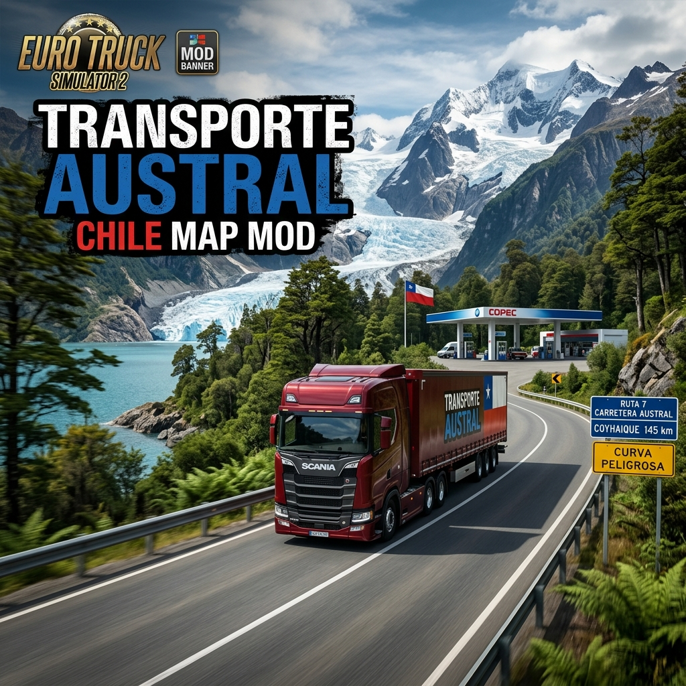
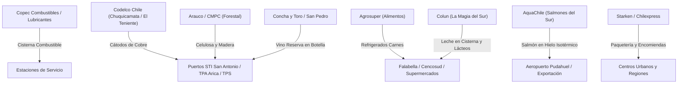

# 🇨🇱 Transporte Austral - Mod de Mapa de Chile para Euro Truck Simulator 2 (ETS2)



[](https://eurotrucksimulator2.com/)
[](https://www.python.org/)
[](LICENSE)
[]()

> **Transporte Austral** es un proyecto de modificación integral de mapa para **Euro Truck Simulator 2**, dedicado a recrear la geografía completa de **Chile** de extremo a extremo: desde el altiplano y el desierto más árido del mundo en el norte, pasando por los valles agrícolas y las autopistas urbanas centrales, hasta los fiordos, lagos, volcanes y las desafiantes rutas de ripio y glaciares de la **Patagonia y Carretera Austral**.

---

## 📑 Tabla de Contenidos

1. [Visión y Filosofía del Proyecto](#-visión-y-filosofía-del-proyecto)
2. [Arquitectura Tecnológica: ¿Por qué Python?](#-arquitectura-tecnológica-por-qué-python)
3. [Las 16 Regiones de Chile Recreadas](#-las-16-regiones-de-chile-recreadas)
4. [Red de Rutas y Carreteras Chilenas](#-red-de-rutas-y-carreteras-chilenas)
5. [Empresas Chilenas y Cadenas Logísticas](#-empresas-chilenas-y-cadenas-logísticas)
6. [Estaciones de Servicio y Áreas de Descanso](#-estaciones-de-servicio-y-áreas-de-descanso)
7. [Cargas y Mercancías Nacionales](#-cargas-y-mercancías-nacionales)
8. [Sistema de Patentes Chilenas Oficiales](#-sistema-de-patentes-chilenas-oficiales)
9. [Suite de Automatización en Python (`tools/`)](#-suite-de-automatización-en-python-tools)
10. [Guía Paso a Paso: SCS Map Editor](#-guía-paso-a-paso-scs-map-editor)
11. [Flujo 3D: Blender y SCS Blender Tools](#-flujo-3d-blender-y-scs-blender-tools)
12. [Estructura del Proyecto](#-estructura-del-proyecto)
13. [Compilación e Instalación](#-compilación-e-instalación)
14. [Hoja de Ruta (Roadmap)](#-hoja-de-ruta-roadmap)

---

## 🌟 Visión y Filosofía del Proyecto

Chile posee una de las geografías más diversas y extremas del planeta: más de **4.300 km de longitud**, una anchura promedio de 177 km y un relieve dominado por la imponente **Cordillera de los Andes**, la Depresión Intermedia y la Cordillera de la Costa. 

Transporte Austral busca capturar esa esencia única para los entusiastas del transporte pesado:
* **Desafíos reales de conducción:** Cuestas pronunciadas (Cuesta Caracoles, Cuesta de Lipán, Cuesta Queulat), rutas costeras sinuosas, vientos cruzados extremos en Magallanes, autopistas de alta velocidad con peajes automatizados (TAG) y pasos fronterizos a más de 3.000 metros de altitud.
* **Economía y logística chilena:** Centros de distribución de retail nacional, faenas mineras en altura de rajo abierto, plantas de celulosa forestal, pesqueras australes y puertos de exportación de contenedores.
* **Ambientación fotorrealista:** Señalización vial reglamentaria según el **Manual de Señalización de Tránsito del MOP (Ministerio de Obras Públicas)**, estaciones de servicio de bandera nacional (Copec, Shell, Petrobras) y vehículos de emergencia de **Carabineros de Chile** y **Bomberos**.

---

## ⚙️ Arquitectura Tecnológica: ¿Por qué Python?

Euro Truck Simulator 2 se ejecuta sobre el motor propietario **Prism3D** de SCS Software. Dicho motor utiliza formatos de datos declarativos propietarios estructurados en sintaxis **SiiNunit** (`.sii`, `.sui`), archivos binarios de sectores (`.base`, `.data`, `.desc`, `.aux`, `.mbd`) y formatos 3D convertidos (`.pmd`, `.pmg`, `.tobj`, `.mat`).

Para el desarrollo y orquestación de un mapa de escala continental como Chile, el **lenguaje de programación más apto y estándar en la industria del modding de SCS es Python 3**, debido a las siguientes razones clave:

1. **Ecosistema Nativo con Blender:** Las herramientas oficiales de SCS Software (**SCS Blender Tools**) están escritas íntegramente como add-ons en Python para Blender. El uso de Python permite crear scripts que se comunican directamente con la API de Blender para la exportación por lotes de modelos 3D (letreros viales, peajes, edificios de Copec, postes de kilometraje MOP).
2. **Generación Procedural de Definiciones:** Un mapa completo requiere miles de líneas de configuración para más de 50 comunas, 18 empresas, cadenas de cargas y reglas viales. Gestionarlas a mano genera inconsistencias de sintaxis. El script [`tools/generator.py`](file:///e:/Proyectos/Transporte_Austral/tools/generator.py) automatiza y sincroniza todas las definiciones a partir de una única fuente de verdad (Single Source of Truth).
3. **Conversión Cartográfica y Georreferenciación:** Chile requiere proyecciones geodésicas (WGS84 a coordenadas planas cartesianas del motor de juego). [`tools/geo_converter.py`](file:///e:/Proyectos/Transporte_Austral/tools/geo_converter.py) traduce grados de Latitud y Longitud reales a los ejes $(X, Z)$ del SCS Map Editor e identifica el sector binario exacto (`sec-0003+0011.base`), ahorrando cientos de horas de cálculo manual.
4. **Validación Estricta y Empaquetado Automático:** El motor de ETS2 no tolera dependencias circulares ni archivos faltantes en los `@include`. [`tools/build.py`](file:///e:/Proyectos/Transporte_Austral/tools/build.py) valida todo el árbol de dependencias, comprueba las cabeceras `SiiNunit` y empaqueta el archivo `.scs` en formato ZIP sin compresión (`STORED`), requisito indispensable para evitar tirones de rendimiento (*stuttering*) durante el renderizado en juego.

---

## 🗺️ Las 16 Regiones de Chile Recreadas

El proyecto abarca la totalidad del territorio continental de Chile, dividido en sus 16 regiones administrativas, sus comunas clave y sus hitos geográficos más emblemáticos:

| N° | Región | Comunas Principales | Hitos y Monumentos Icónicos |
| :--- | :--- | :--- | :--- |
| **XV** | **Arica y Parinacota** | Arica, Putre, Camarones | El Morro de Arica, Valle de Azapa, Lago Chungará, Volcán Parinacota, Paso Chacalluta |
| **I** | **Tarapacá** | Iquique, Alto Hospicio, Pozo Almonte, Pica | Bajada de Alto Hospicio, Salitreras Humberstone, Cerro Dragón, Puerto de Iquique, ZOFRI |
| **II** | **Antofagasta** | Antofagasta, Calama, San Pedro, Mejillones | Monumento Natural La Portada, Mano del Desierto (Ruta 5), Rajo de Chuquicamata, Valle de la Luna |
| **III** | **Atacama** | Copiapó, Caldera, Vallenar, Chañaral | Desierto Florido, Playas de Bahía Inglesa, Mina San José (los 33), Parque Pan de Azúcar |
| **IV** | **Coquimbo** | La Serena, Coquimbo, Ovalle, Los Vilos | Faro Monumental de La Serena, Cruz del Tercer Milenio, Valle del Elqui, Cuesta Porotitos |
| **V** | **Valparaíso** | Valparaíso, Viña del Mar, San Antonio, Los Andes | Ascensores patrimoniales, Reloj de Flores, Puerto STI de San Antonio, Cuesta Caracoles (Paso Los Libertadores) |
| **RM** | **Metropolitana de Santiago** | Santiago Centro, San Bernardo, Pudahuel, Quilicura | Gran Torre Costanera Center, Cerro San Cristóbal, Hub Logístico San Bernardo, Autopista Central |
| **VI** | **O'Higgins** | Rancagua, San Fernando, Santa Cruz, Rengo | Sewell y Mina El Teniente, Carretera del Vino (Colchagua), Complejo Agroindustrial Agrosuper |
| **VII** | **Maule** | Talca, Curicó, Linares, Constitución | Río Maule, Planta Celulosa Arauco Constitución, Radal Siete Tazas, Viñedos del Maule |
| **XVI** | **Ñuble** | Chillán, San Carlos, Bulnes, Quirihue | Mercado Central de Chillán (cecinas artesanales), Volcán Chillán, Termas de Chillán |
| **VIII** | **Biobío** | Concepción, Talcahuano, Los Ángeles, Coronel | Puentes sobre el Río Biobío, Reliquia Histórica Huáscar, Complejo Forestal MAPA, Salto del Laja |
| **IX** | **La Araucanía** | Temuco, Villarrica, Pucón, Angol, Victoria | Volcán Villarrica humeante, Cerro Ñielol, Bosques de Araucarias milenarias, Viaducto del Malleco |
| **XIV** | **Los Ríos** | Valdivia, La Unión, Río Bueno, Panguipulli | Río Calle-Calle con lobos marinos, Cervecería Kunstmann Torobayo, Planta Láctea Colun, Puentes de Niebla |
| **X** | **Los Lagos** | Puerto Montt, Osorno, Castro, Quellón, Chaitén | Inicio de Carretera Austral, Transbordadores Canal de Chacao, Palafitos de Castro, Hito Cero Panamericana |
| **XI** | **Aysén del Gral. Ibáñez** | Coyhaique, Puerto Aysén, Puerto Chacabuco, Cochrane, Villa O'Higgins | Capillas de Mármol en Lago General Carrera, Cumbres afiladas del Cerro Castillo, Ventisquero Colgante Queulat, Cuesta Queulat |
| **XII** | **Magallanes y Antártica** | Punta Arenas, Puerto Natales, Porvenir | Macizo de las Torres del Paine, Estrecho de Magallanes, Barcaza Primera Angostura en Tierra del Fuego |

---

## 🛣️ Red de Rutas y Carreteras Chilenas

La red vial chilena tiene particularidades únicas que se recrean con precisión milimétrica:

### 1. Ruta 5 Panamericana (Eje Troncal Nacional)
* **Ruta 5 Norte (Arica - Santiago):** Dobles vías modernas alternadas con tramos desérticos épicos, amplias rectas rodeadas de cerros de arena, cuestas desafiantes (Cuesta Pajonales, Cuesta Buenos Aires) y plazas de peaje troncales.
* **Autopistas Urbanas de Santiago:** Sistema de autopistas concesionadas con **pórticos TAG electrónicos**, túneles bajo el Río Mapocho (Costanera Norte) y enlaces de alta capacidad en Autopista Central y Américo Vespucio.
* **Ruta 5 Sur (Santiago - Puerto Montt - Chiloé):** Doble calzada con separador central arbolado, puentes sobre ríos caudalosos, áreas de pesaje de camiones de la Dirección de Vialidad, paso por el By-pass Rancagua, Talca, Chillán, Temuco y el viaducto del Río Biobío.
* **Cruce Marítimo Bimodal Canal de Chacao:** Cruce en barcaza/transbordador para ingresar a la Isla Grande de Chiloé (Ancud, Castro y Quellón).

### 2. Ruta 7 (La Carretera Austral)
Considerada una de las rutas escénicas y de aventura más famosas del mundo:
* **Tramo Norte (Puerto Montt a Chaitén):** Ruta Bimodal con transbordadores marítimos entre Hornopirén, Leptepu y Caleta Gonzalo, atravesando densos bosques templados lluviosos y fiordos.
* **Tramo Central (Puyuhuapi - Coyhaique):** Ascenso dramático por la **Cuesta Queulat**, curvas cerradas en pendiente extrema, cascadas junto a la calzada y puentes colgantes mecanos monovía de madera y acero.
* **Tramo Sur (Coyhaique a Villa O'Higgins):** Bordeando el Río Baker de aguas turquesas, Lago General Carrera y el final de la ruta en Villa O'Higgins. Superficie de ripio compactado de alta exigencia para la suspensión del camión.

### 3. Rutas Conexas y Pasos Internacionales
* **Ruta 68 (Santiago - Valparaíso / Viña del Mar):** Túnel Lo Prado y Túnel Zapata, Cuesta Zapata y descenso hacia la costa.
* **Ruta 78 (Autopista del Sol):** Conexión logística de camiones cargueros de contenedores y fruta fresca entre Santiago, Melipilla y el megapuerto de San Antonio.
* **Ruta 60-CH (Paso Los Libertadores):** La legendaria subida de los **Caracoles de Juncal**, con más de 29 curvas en herradura que ascienden hacia la boca del túnel Cristo Redentor rumbo a Argentina.
* **Ruta 9 y Rutas Fueguinas (Magallanes):** Pampas patagónicas azotadas por ráfagas de viento blanco y cruce en ferry por el Estrecho de Magallanes (Punta Delgada - Bahía Azul).

---

## 🏢 Empresas Chilenas y Cadenas Logísticas

El mod incorpora las compañías reales más representativas de la economía chilena, cada una con patios de carga, depósitos de remolques y mercancías asociadas:



### Directorio de 47 Empresas Chilenas Implementadas en el Mapa

El mod conecta los 240 sectores del mapa con 47 empresas emblemáticas chilenas distribuidas estratégicamente a lo largo de las 16 regiones y 52 comunas:

#### 1. ⛽ Combustibles, Energía y Refinerías
* **Copec (`copec`):** Mayor distribuidora nacional de hidrocarburos. Presente en las 52 comunas con patios de camiones, paradas de autopista y tiendas **Pronto Copec** y **Punto Copec**.
* **Shell Enex (`shell_cl`):** Red de estaciones de servicio y áreas de descanso con tiendas **Upa!** y **Upita** en las principales ciudades y rutas troncales.
* **Petrobras Esmax (`petrobras`, `petrobras_cl`):** Red interurbana de abastecimiento y tiendas **Spacio 1**.
* **Aramco Chile (`aramco`):** Nueva red global de combustibles con estaciones de alto flujo en autopistas chilenas.
* **ENAP (`enap`):** Empresa Nacional del Petróleo con refinerías en Concón, Biobío y plantas de extracción en Magallanes (movimiento de petróleo crudo, gasolinas y productos químicos).

#### 2. ⛏️ Minería, Siderurgia y Química Pesada
* **Codelco (`codelco`):** Corporación Nacional del Cobre. Operaciones en Calama (Chuquicamata), Rancagua (El Teniente), Los Andes (Andina) y Diego de Almagro (Salvador). Cargas de cátodos de cobre, concentrado, ácido sulfúrico y maquinaria pesada.
* **Minera Escondida - BHP (`escondida`):** El mayor yacimiento de cobre a rajo abierto del planeta, ubicado en Antofagasta y Mejillones.
* **SQM (`sqm`):** Sociedad Química y Minera de Chile. Explotación de litio en el Salar de Atacama, nitratos y yodo en Tarapacá y Antofagasta.
* **CAP Acero (`cap_acero`):** Siderúrgica Huachipato (Talcahuano) y Compañía Minera del Pacífico en Copiapó/Vallenar (barras de acero, rieles y minerales de hierro).
* **Molymet (`molymet`):** Mayor procesador mundial de molibdeno y renio con planta industrial en Nos / San Bernardo.

#### 3. 🌲 Forestal, Celulosa y Madera
* **Arauco (`arauco`):** Gigante forestal con complejos de clase mundial: Complejo MAPA (Arauco), Horcones, Planta Celulosa Constitución y Aserraderos en Biobío y Maule. Fletes de fardos de celulosa Kraft y madera aserrada.
* **Empresas CMPC (`cmpc`):** "La Papelera", Forestal Mininco y plantas de celulosa y cartones en Los Ángeles, Laja y Puente Alto.

#### 4. 🥩 Alimentos, Lácteos, Carnes y Agroindustria
* **Agrosuper (`agrosuper`):** Mayor productor cárnico de Chile (Super Pollo, Super Cerdo, La Crianza, Sopraval). Despachos frigoríficos desde Lo Miranda, Rosario y San Bernardo hacia todo Chile.
* **Colun (`colun`):** Cooperativa Agrícola y Lechera de La Unión ("La Magia del Sur"). Fletes de leche cruda en camiones cisterna isotérmicos, quesos y mantequillas desde Los Ríos hacia el resto del país.
* **Soprole (`soprole`):** Líder lácteo nacional con plantas de acopio y elaboración de yogures, leches y postres en San Bernardo y Los Lagos.
* **Carozzi (`carozzi`):** Megacomplejo alimenticio en Nos (Pastas Carozzi, Galletas Costa, Chocolates Ambrosoli y Harinas).
* **Empresas Iansa (`iansa`):** Plantas agroindustriales de azúcar de remolacha, endulzantes y pulpas de tomate en Los Ángeles, Chillán y Maule.
* **Panadería Ideal - Bimbo (`ideal_cl`):** Mayor planta de panificación de Chile en Quilicura y distribución continua a nivel nacional.
* **Watt's (`watts`):** Procesadora de jugos Watt's, leches Loncoleche, margarinas Calo y aceites Chef en Osorno y San Bernardo.
* **Frigorífico Simunovic (`simunovic`):** Planta faenadora en Punta Arenas especializada en cortes de cordero patagónico y carnes de exportación.
* **Dole Chile Frutícola (`dole_cl`):** Packing de paltas Hass de Quillota/Petorca, uvas de mesa, arándanos y manzanas para los puertos de Valparaíso y San Antonio.
* **AquaChile (`aquachile`):** Mayor salmonera de Chile con centros de cultivo y plantas de empaque en Puerto Montt, Castro, Quellón y Aysén.

#### 5. 🍻 Bebidas, Cervezas y Viñedos
* **CCU (`ccu`):** Compañía de Cervecerías Unidas. Cervezas Cristal, Escudo y Royal Guard; gaseosas Bilz y Pap; y aguas minerales Cachantún.
* **Coca-Cola Andina (`andina`):** Embotelladora en Renca y San Bernardo para la zona central de Chile.
* **Coca-Cola Embonor (`embonor`):** Distribución de bebidas gaseosas, jugos y aguas en las zonas norte y sur (Arica, Iquique, Concepción, Temuco).
* **Viña Concha y Toro (`concha_toro`):** La viña más icónica de Chile (Casillero del Diablo, Don Melchor) con bodegas en Pirque, Curicó y San Fernando.
* **Cervecería Kunstmann (`kunstmann`):** Cerveza craft tradicional nacida en Torobayo (Valdivia).
* **Cervecería Austral (`austral_pza`):** La cerveza más austral del mundo, elaborada en Punta Arenas con aguas de la Patagonia.

#### 6. 🛒 Retail, Supermercados y Mejoramiento del Hogar
* **Lider - Walmart Chile (`lider`):** Red de hipermercados Lider, Express de Lider y el megacentro de distribución Lo Aguirre en Pudahuel.
* **Cencosud (`cencosud`):** Cadena de abastecimiento de Hipermercados Jumbo, Supermercados Santa Isabel y tiendas de construcción Easy.
* **Unimarc (`unimarc`):** Supermercado presente en las 16 regiones de Chile, desde Arica hasta Magallanes.
* **Falabella Logística (`falabella`):** Grandes tiendas por departamento y centros logísticos en San Bernardo y Pudahuel.
* **Ripley Retail (`ripley`):** Tiendas departamentales, electrónica y centro de distribución Pudahuel.
* **Homecenter Sodimac (`sodimac`):** Red líder de ferretería, mejoramiento del hogar y Sodimac Constructor (cemento, maderas, herramientas).

#### 7. 🏗️ Cemento y Materiales de Construcción
* **Cemento Melón (`melon`):** Producción histórica de cemento y áridos desde La Calera y San Antonio.
* **Cementos Bío Bío - CBB (`cbb_cemento`):** Plantas de molienda de cemento y cal en Talcahuano, Curicó y Teno.
* **Cementos Polpaico (`polpaico`):** Complejos de cemento y hormigón en Cerro Blanco (Tiltil) y Coronel.

#### 8. 📦 Courier, Encomiendas y Logística Nacional
* **Starken (`starken`):** Hub de paquetería express y carga pesada del grupo TurBus con terminales en todo el territorio chileno.
* **Chilexpress (`chilexpress`):** Courier de paquetería urgente y entregas e-commerce nacional con hubs en aeropuertos y carreteras.
* **CorreosChile (`correos_cl`):** Correo oficial del Estado de Chile y su Centro Tecnológico Postal (CTP) en el Aeropuerto de Pudahuel.
* **Blue Express (`bluex`):** Operador logístico líder en distribución de última milla para comercio electrónico.

#### 9. ⚓ Puertos, Terminales Marítimos y Conectividad Austral
* **STI San Antonio (`sti_san_ant`):** San Antonio Terminal Internacional, el puerto de mayor transferencia de contenedores del país.
* **TPS Valparaíso (`tps_valp`):** Terminal Pacífico Sur, muelle histórico para el embarque de fruta fresca y vinos chilenos.
* **TPA Arica (`tpa_arica`):** Terminal Puerto Arica, muelle multipropósito del extremo norte y salida bioceánica.
* **Puerto Coronel (`pto_coronel`):** Principal puerto de exportación de celulosa, tableros y maderas del sur de Chile.
* **TABSA (`tabsa`):** Transbordadora Austral Broom. Servicio de ferries y barcazas para cruce de camiones pesados en Primera Angostura (Estrecho de Magallanes) y Porvenir (Tierra del Fuego).

---

## ⛽ Estaciones de Servicio y Áreas de Descanso

En el mod, las paradas de combustible han sido diseñadas reflejando los puntos de parada reales más concurridos por los camioneros chilenos en la Ruta 5:

* **Copec Pronto:** Estaciones de gran formato con estacionamientos para camiones de 45 toneladas, duchas para conductores, cajeros y restaurantes Pronto (ejemplos recreados: *Copec Pronto San Francisco de Mostazal*, *Copec Pronto Los Vilos*, *Copec Salto del Laja*, *Copec La Negra en Antofagasta*).
* **Shell Upa!:** Estaciones con arquitectura moderna Shell Enex y áreas de descanso.
* **Petrobras Spacio 1:** Estaciones urbanas e interurbanas.
* **Plazas de Pesaje MOP:** Estaciones de pesaje por eje obligatorias con básculas activas donde el camión debe ingresar si la señal luminosa lo indica.

---

## 📦 Cargas y Mercancías Nacionales

Se han creado cargas a la medida de la economía chilena en [`def/cargo/`](file:///e:/Proyectos/Transporte_Austral/def/cargo/):

* `catodos_cobre`: Cátodos electrolíticos de cobre grado A de alta pureza (24 toneladas, alto valor).
* `celulosa_fardo`: Fardos prensados de celulosa Kraft para embalaje y exportación marítima (22,5 toneladas).
* `salmon_fresco`: Cajas isotérmicas con salmón del Atlántico fresco sobre lecho de hielo (19 toneladas, carga refrigerada perecible).
* `vino_reserva`: Pallets de botellas de vino chileno reserva en barricas y cajas (18,5 toneladas, frágil y valiosa).
* `leche_sur`: Cisterna alimentaria con leche entera cruda y pasteurizada Colun (25 toneladas líquidas).
* `combustible_cl`: Cisterna de hidrocarburos con gasolinas de 93, 95, 97 octanos y Diésel Copec Ultra (26 toneladas, mercancía ADR inflamable).
* `palta_hass`: Pallets de palta Hass de los valles de Quillota y Petorca (17,5 toneladas, refrigerada).
* `encomiendas_cl`: Cargas consolidadas de mensajería y paquetería Starken / Chilexpress (12 toneladas).

---

## 🪪 Sistema de Patentes Chilenas Oficiales

En Chile, el **Servicio de Registro Civil e Identificación** regula el formato de patentes vehiculares (implementado en [`def/country/chile/license_plates.sui`](file:///e:/Proyectos/Transporte_Austral/def/country/chile/license_plates.sui)):

* **Estructura oficial:** `BB·BB-00` (4 consonantes seguidas de 2 números).
* **Filtro estricto del Registro Civil:** Quedan formalmente excluidas las **5 vocales** ($A, E, I, O, U$) para evitar palabras indecorosas, y también las letras $M, N, Ñ, Q$ para evitar falsificaciones o confusiones ópticas con la $0, 1, O$.
* **Patentes de semirremolques:** Incorpora series con prefijo `R` para remolques pesados (`R0·12-34`).

---

## 🐍 Suite de Automatización en Python (`tools/`)

Ubicada en la carpeta [`tools/`](file:///e:/Proyectos/Transporte_Austral/tools/):

### 1. `generator.py` (Generador de Definiciones)
Regenera de forma automática los archivos `.sui` y `.sii` de ciudades, empresas, cargas y estaciones de servicio con un solo comando:
```bash
python tools/generator.py
```

### 2. `geo_converter.py` (Conversor GPS a Coordenadas de Juego)
Permite transformar cualquier coordenada real de Chile a los ejes de coordenadas del mapa y calcular en qué archivo de sector caerá:
```bash
# Ejemplo: Obtener coordenadas de las Torres del Paine
python tools/geo_converter.py -51.7269 -72.5069
```
*Salida:*
```text
Lat: -51.7269, Lon: -72.5069 -> ETS2 X: -7918, Z: 106970 -> Sector: sec-0002+0026.base
```

### 3. `build.py` (Compilador y Empaquetador `.scs`)
Valida la integridad de los archivos, comprueba que ningún include esté roto y genera el archivo empaquetado final `dist/Transporte_Austral_Chile.scs`:
```bash
python tools/build.py
```
*Si detecta la instalación de ETS2 en tu equipo, copiará automáticamente el `.scs` a tu carpeta `Documents/Euro Truck Simulator 2/mod/`.*

### 4. `launcher.py` / `iniciar_trayectoria.bat` (Selector de Regiones y Sorteo Aleatorio de Comunas)
Permite al conductor seleccionar cualquiera de las 16 regiones de Chile y sortea automáticamente una comuna al azar con sus coordenadas y empresas disponibles para iniciar su recorrido:
```bash
# Ejecutar desde terminal
python tools/launcher.py

# O hacer doble clic en el archivo raíz:
iniciar_trayectoria.bat
```

### 5. `sector_helper.py` (Gestor de Sectores y Copias de Seguridad)
Audita los sectores binarios creados en `map/chile/` y genera backups con fecha y hora:
```bash
# Auditar sectores guardados
python tools/sector_helper.py

# Crear copia de seguridad completa del mapa
python tools/sector_helper.py backup
```

---

## 🛠️ Guía Paso a Paso: SCS Map Editor

Para comenzar a trazar las carreteras y colocar los modelos en el editor de ETS2:

### Paso 1: Habilitar Consola y Modo Desarrollador
Abre el archivo `Documents\Euro Truck Simulator 2\config.cfg` en el Bloc de Notas y modifica estos dos parámetros:
```text
uset g_developer "1"
uset g_console "1"
```

### Paso 2: Ejecutar el Editor
Puedes ejecutar el script automatizado [`tools/run_editor.bat`](file:///e:/Proyectos/Transporte_Austral/tools/run_editor.bat) o lanzar manualmente desde la terminal:
```powershell
& "C:\Program Files (x86)\Steam\steamapps\common\Euro Truck Simulator 2\bin\win_x64\eurotrucks2.exe" -edit chile -force_mods
```

### Paso 3: Comandos Esenciales de la Consola del Editor (Tecla `~`)
* `c_goto <X> 100 <Z>`: Salta la cámara instantáneamente a las coordenadas de cualquier ciudad calculadas con `geo_converter.py`.
* `save chile`: Guarda todos los cambios en los sectores binarios dentro de `map/chile/`.
* `load chile`: Recarga el mapa guardado.
* `F5`: Abre el diálogo de búsqueda de sectores e información de entidades.
* `E`: Herramienta de colocación de carreteras (Road Item).
* `P`: Herramienta de prefabs y cruces viales (Prefab Item).
* `M`: Mover o ajustar nodos de elevación del terreno.
* `C`: Herramienta de ciudades (City Node) para vincular los nombres del mapa con las definiciones de `def/city/*.sui`.

---

## 🎨 Flujo 3D: Blender y SCS Blender Tools

Para modelar activos característicos de Chile (pórticos TAG de autopistas, casetas de peaje manual MOP, letreros viales verdes y azules chilenos, garitas de Carabineros):

1. **Instalar Blender:** Versión recomendada 3.6 LTS o 4.x.
2. **Instalar SCS Blender Tools:** Descarga oficial del portal de desarrolladores de SCS Software e instalar como plugin en Blender.
3. **Configurar el Project Root:** Apuntar el directorio base a la raíz de este repositorio (`Transporte_Austral`).
4. **Texturizado y Shaders:**
   * Utilizar shaders SCS (`eut2.dif.spec.weight`, `eut2.road.airship`, etc.).
   * Las texturas deben guardarse en formato DDS con canales alfa correctos (BC1/DXT1 para opacas, BC3/DXT5 para transparencias).
5. **Exportación:** Exportar las piezas usando el operador SCS para generar los modelos listos para el motor del juego.

---

## 📁 Estructura del Proyecto

```text
Transporte_Austral/
│
├── manifest.sii                  # Descriptor y metadatos del mod para ETS2
├── description.txt               # Descripción formateada con bbcode para el juego
├── mod_icon.png                  # Icono de portada oficial en el Gestor de Mods
├── README.md                     # Manual maestro y documentación arquitectónica
│
├── def/                          # Definiciones SiiNunit del motor Prism3D
│   ├── country.chile.sii         # Inclusión maestra de país
│   ├── country/
│   │   ├── chile.sui             # Datos país: moneda CLP, límites velocidad, huso horario
│   │   └── chile/
│   │       └── license_plates.sui# Patentes chilenas (BB-BB-00) según Registro Civil
│   ├── city.chile.sii            # Inclusión maestra de ciudades
│   ├── city/                     # 52 archivos .sui para comunas y ciudades de Chile
│   ├── company.chile.sii         # Inclusión maestra de empresas
│   ├── company/                  # 18 empresas chilenas (Copec, Codelco, Arauco, etc.)
│   ├── cargo.chile.sii           # Inclusión maestra de cargas nacionales
│   ├── cargo/                    # 8 cargas típicas chilenas
│   └── world/
│       └── gasoline_station.chile.sii # Mapeo de marcas Copec Pronto, Shell Upa, Petrobras
│
├── map/                          # Base de datos y sectores del SCS Map Editor
│   ├── chile.mbd                 # Archivo de cabecera del mapa
│   ├── README.txt                # Instrucciones de guardado de sectores
│   └── chile/                    # Sectores binarios (secXXXX+YYYY.base/data/desc)
│
├── tools/                        # Suite de desarrollo y automatización en Python
│   ├── generator.py              # Generador dinámico de definiciones .sii y .sui
│   ├── geo_converter.py          # Conversor de GPS WGS84 chileno a coordenadas SCS
│   ├── build.py                  # Validador y empaquetador del archivo final .scs
│   ├── sector_helper.py          # Auditor y respaldador de sectores binarios
│   ├── requirements.txt          # Requisitos de Python (zero-dependency core)
│   └── run_editor.bat            # Lanzador automático de 1 clic para el Map Editor
│
└── dist/                         # Archivo final compilado listo para jugar
    └── Transporte_Austral_Chile.scs
```

---

## 🚀 Compilación e Instalación

### Método 1: Automatizado con Python
Ejecuta el script de empaquetado:
```bash
python tools/build.py
```
El script generará el archivo `Transporte_Austral_Chile.scs` en la carpeta `dist/` y lo colocará automáticamente en tu carpeta de mods si tienes ETS2 instalado.

### Método 2: Instalación Manual
1. Copia el archivo `dist/Transporte_Austral_Chile.scs`.
2. Pégalo en tu carpeta de mods de Euro Truck Simulator 2:
   ```text
   C:\Users\<TuUsuario>\Documents\Euro Truck Simulator 2\mod\
   ```
3. Inicia Euro Truck Simulator 2.
4. En la pantalla de selección de perfil, haz clic en **Gestor de Modificaciones**.
5. Activa el mod **"Transporte Austral - Mapa de Chile"** y dale máxima prioridad.
6. Si juegas como mapa independiente (*Standalone*), al crear un perfil nuevo selecciona el módulo de mapa `chile.mbd` en lugar de `europe.mbd`.

---

## 🗺️ Hoja de Ruta (Roadmap)

- [x] **Fase 1: Fundación y Automatización**
  - [x] Estructura base de paquetes `manifest.sii` y diseño de icono oficial.
  - [x] Suite de automatización en Python (`generator.py`, `geo_converter.py`, `build.py`, `sector_helper.py`).
  - [x] Base de datos y definiciones de las 16 regiones de Chile y 52 comunas.
  - [x] Catálogo de empresas chilenas (Copec, Codelco, Arauco, Agrosuper, Colun, etc.).
  - [x] Sistema oficial de patentes chilenas sin vocales ni caracteres ambiguos.
  - [x] Mapeo de estaciones de servicio Copec Pronto, Shell Upa! y Petrobras Spacio 1.
- [ ] **Fase 2: Trazado en Map Editor (Zona Central)**
  - [ ] Modelado de la Ruta 5 Sur (Santiago - Rancagua - Talca).
  - [ ] Modelado de la Ruta 68 (Santiago - Valparaíso / Viña del Mar) con peajes y túneles.
  - [ ] Conexión al puerto de San Antonio (Ruta 78 Autopista del Sol).
- [ ] **Fase 3: Carreteras Australes y Geografía Extrema**
  - [ ] Paso Los Libertadores y la Cuesta Caracoles (Ruta 60-CH).
  - [ ] Puerto Montt a Chaitén (Ruta Bimodal con transbordadores).
  - [ ] Trazado de la Carretera Austral (Ruta 7) hasta Coyhaique y Villa O'Higgins.
- [ ] **Fase 4: Extremos Norte y Austral**
  - [ ] Ruta 5 Norte a través del Desierto de Atacama y La Portada de Antofagasta.
  - [ ] Magallanes: Punta Arenas, Torres del Paine y cruce a Tierra del Fuego.
- [ ] **Fase 5: Modelado 3D de Señalética MOP y Activos Chilenos**
  - [ ] Prefabs de pórticos TAG y peajes troncales chilenos.
  - [ ] Vehículos de tráfico IA: furgones de Carabineros de Chile y buses interurbanos.

---

## 👥 Créditos y Comunidad

* **Equipo de Desarrollo:** Transporte Austral Team
* **Simulador:** [Euro Truck Simulator 2](https://eurotrucksimulator2.com/) por SCS Software.
* **Agradecimientos:** Comunidad chilena de camioneros virtuales, modders de la comunidad SCS y a todos los amantes de las rutas de Chile.

*¡Buen viaje y nos vemos en la ruta!* 🇨🇱🚛